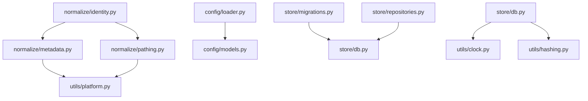

# Design Document: Incomplete Modules Implementation

## Overview

This design covers the implementation of nine incomplete modules in the playtrace project that provide essential infrastructure for metadata extraction, path normalization, configuration management, database operations, and utility functions. These modules support the evidence-first architecture where Windows artifacts are collected, parsed into evidence records, normalized into canonical forms, and rebuilt into executables, sessions, and titles.

The modules are organized into four packages:
- **normalize/** - Metadata extraction and path normalization
- **config/** - Configuration loading and validation
- **store/** - Database migrations and repository pattern
- **utils/** - Clock, hashing, and platform detection utilities

All implementations follow the project's Python 3.12 conventions: `from __future__ import annotations`, `@dataclass(slots=True)`, typed interfaces, and snake_case naming.

## Architecture

### Module Dependencies



### Data Flow

1. **Metadata Extraction**: Windows PE files → metadata extractor → version info fields
2. **Path Normalization**: Raw paths → path normalizer → canonical lowercase paths
3. **Configuration**: TOML files → config loader → validated ConfigModel
4. **Database Operations**: Schema version check → migrations → current schema
5. **Repository Access**: Entity operations → repositories → Database connection
6. **Utilities**: System calls → clock/hasher/platform → normalized values

## Components and Interfaces

### 1. Metadata Extractor (normalize/metadata.py)

**Purpose**: Extract version information and digital signatures from Windows PE executables.

**Dependencies**:
- `pefile` library for PE file parsing
- `win32api` / `win32security` for signature extraction (Windows only)
- `utils/platform.py` for platform detection

**Public Interface**:

```python
@dataclass(slots=True)
class ExecutableMetadata:
    product_name: str | None
    original_filename: str | None
    file_description: str | None
    company_name: str | None
    signer: str | None

class MetadataExtractor:
    def extract(self, path: str | Path) -> ExecutableMetadata | None:
        """Extract metadata from PE file. Returns None if file is invalid."""
        
    def _extract_version_info(self, pe: pefile.PE) -> dict[str, str]:
        """Extract version info resource fields."""
        
    def _extract_signature(self, path: Path) -> str | None:
        """Extract digital signature signer name (Windows only)."""
        
    def _normalize_field(self, value: str | None) -> str | None:
        """Strip whitespace and return None for empty strings."""
```

**Implementation Strategy**:
- Use `pefile.PE()` to parse executable
- Extract `StringFileInfo` from version resources
- Map common field names: ProductName, OriginalFilename, FileDescription, CompanyName
- On Windows, use `win32security.CryptQueryObject` for signature extraction
- Return None for all fields if PE parsing fails
- Normalize all extracted strings (strip whitespace, None for empty)


### 2. Path Normalizer (normalize/pathing.py)

**Purpose**: Convert Windows paths to canonical lowercase form for consistent identity keys.

**Dependencies**:
- `pathlib.PureWindowsPath` for path manipulation
- `os.path.expandvars` with Windows-style case-insensitive fallback expansion
- `pathlib.Path.resolve()` for host-safe relative path resolution during tests

**Public Interface**:

```python
class PathNormalizer:
    def normalize(self, path: str | None) -> str | None:
        """Normalize Windows path to canonical lowercase form."""
        
    def _strip_quotes(self, path: str) -> str:
        """Remove surrounding quotes from path."""
        
    def _expand_variables(self, path: str) -> str:
        """Expand environment variables like %ProgramFiles%."""

    def _expand_variable(self, match: re.Match[str]) -> str:
        """Expand one Windows-style environment variable case-insensitively."""
        
    def _to_absolute(self, path: str) -> str:
        """Convert relative path to absolute."""
        
    def _to_backslashes(self, path: str) -> str:
        """Convert forward slashes to backslashes."""
```

**Implementation Strategy**:
- Return None for None or empty input
- Strip leading/trailing whitespace and quotes
- Expand environment variables using `os.path.expandvars` plus a case-insensitive `%VAR%` fallback lookup
- Convert forward slashes to backslashes
- Resolve to absolute path if relative
- Convert entire path to lowercase
- Use `PureWindowsPath` for consistent Windows path handling

### 3. Config Loader (config/loader.py)

**Purpose**: Load and parse TOML configuration files into validated ConfigModel instances.

**Dependencies**:
- `tomllib` (Python 3.11+) for TOML parsing
- `config/models.py` for ConfigModel dataclass

**Public Interface**:

```python
class ConfigLoader:
    def load(self, path: Path | None = None) -> ConfigModel:
        """Load config from TOML file or return defaults."""
        
    def _parse_toml(self, path: Path) -> dict[str, Any]:
        """Parse TOML file into dictionary."""
        
    def _apply_defaults(self, data: dict[str, Any]) -> dict[str, Any]:
        """Fill in missing fields with default values."""
```

**Implementation Strategy**:
- If path is None or doesn't exist, return default ConfigModel
- Use `tomllib.load()` to parse TOML
- Catch `tomllib.TOMLDecodeError` and raise descriptive error
- Ignore unknown fields (only extract known config keys)
- Apply defaults for missing optional fields
- Pass validated dict to ConfigModel constructor

### 4. Config Model (config/models.py)

**Purpose**: Typed configuration data model with validation.

**Dependencies**:
- `models/enums.py` for SourceName enum

**Public Interface**:

```python
@dataclass(slots=True, init=False)
class ConfigModel:
    defaults: DefaultsConfig = field(default_factory=DefaultsConfig)
    scan: ScanConfig = field(default_factory=ScanConfig)
    me: MeConfig = field(default_factory=MeConfig)
    report: ReportConfig = field(default_factory=ReportConfig)
    doctor: DoctorConfig = field(default_factory=DoctorConfig)
    titles: TitlesConfig = field(default_factory=TitlesConfig)
    sessions: SessionsConfig = field(default_factory=SessionsConfig)
    inspect: InspectConfig = field(default_factory=InspectConfig)
    sources: SourcesConfig = field(default_factory=SourcesConfig)
    map: MapConfig = field(default_factory=MapConfig)
    export: ExportConfig = field(default_factory=ExportConfig)
    profiles: dict[str, ProfileConfig] = field(default_factory=dict)

    @property
    def session_merge_dedupe_window_minutes(self) -> int: ...

    @property
    def default_sources(self) -> list[str]: ...

    @property
    def classification_overrides(self) -> dict[str, str]: ...
```

**Implementation Strategy**:
- Use `@dataclass(slots=True, init=False)` with nested command/default/profile sections
- Keep the legacy top-level constructor convenience for `session_merge_dedupe_window_minutes`, `default_sources`, and `classification_overrides`
- Surface those legacy values through properties backed by `defaults.reconstruction` and `defaults.classification`
- Validate `session_merge_dedupe_window_minutes > 0`
- Validate each source in `default_sources` is a valid SourceName
- Raise `ValueError` with descriptive message on validation failure


### 5. Migration Engine (store/migrations.py)

**Purpose**: Apply schema version upgrades to SQLite databases.

**Dependencies**:
- `store/db.py` for Database connection
- `store/schema.py` for SCHEMA_SQL

**Public Interface**:

```python
@dataclass(slots=True)
class Migration:
    version: int
    description: str
    sql: str

class MigrationEngine:
    def __init__(self, db: Database) -> None:
        """Initialize with database connection."""
        
    def current_version(self) -> int:
        """Get current schema version from database."""
        
    def apply_migrations(self, target_version: int) -> None:
        """Apply all migrations from current to target version."""
        
    def _ensure_version_table(self) -> None:
        """Create schema_version table if it doesn't exist."""
        
    def _apply_migration(self, migration: Migration) -> None:
        """Apply single migration in transaction."""
        
    def _record_migration(self, version: int) -> None:
        """Record applied migration version and timestamp."""
        
    @property
    def migrations(self) -> list[Migration]:
        """Return list of available migrations."""
```

**Schema Version Table**:

```sql
CREATE TABLE IF NOT EXISTS schema_version (
    version INTEGER PRIMARY KEY,
    applied_at TEXT NOT NULL,
    description TEXT NOT NULL
);
```

**Implementation Strategy**:
- Create `schema_version` table if missing, set version to 1
- Query current version from `schema_version` table
- If current < target: apply migrations in order
- If current == target: no-op
- If current > target: raise error (database from newer version)
- Wrap each migration in transaction with rollback on failure
- Record version, timestamp, and description after successful migration
- Initial migration list can be empty (version 1 is bootstrap schema)

### 6. Repository Pattern (store/repositories.py)

**Purpose**: Encapsulate database queries with typed entity access.

**Dependencies**:
- `store/db.py` for Database connection
- `models/` for entity dataclasses

**Public Interface**:

```python
T = TypeVar("T")

class Repository(Generic[T]):
    def __init__(self, db: Database, table_name: str) -> None:
        """Initialize repository with database and table name."""
        
    def find_by_id(self, entity_id: str) -> T | None:
        """Find entity by primary key."""
        
    def find_all(self) -> list[T]:
        """Find all entities."""
        
    def save(self, entity: T) -> T:
        """Insert or update entity."""
        
    def delete(self, entity_id: str) -> None:
        """Delete entity by primary key."""
        
    def _row_to_entity(self, row: sqlite3.Row) -> T:
        """Convert database row to typed entity (abstract)."""

class ExecutableRepository(Repository[ExecutableIdentity]):
    def find_by_normalized_key(self, key: str) -> ExecutableIdentity | None:
        """Find executable by normalized key."""

class SessionRepository(Repository[SessionRecord]):
    def find_by_exe_id(self, exe_id: str) -> list[SessionRecord]:
        """Find all sessions for an executable."""

class TitleRepository(Repository[TitleAggregate]):
    def find_by_classification(self, classification: Classification) -> list[TitleAggregate]:
        """Find titles by classification."""

class MappingRepository(Repository[UserMapping]):
    def find_by_target(self, target: str) -> UserMapping | None:
        """Find mapping by target identifier."""
```

**Implementation Strategy**:
- Base `Repository` class provides common CRUD operations
- Specialized repositories extend base with domain-specific queries
- Use Database.connect() for connection management
- Convert sqlite3.Row to dataclass instances in `_row_to_entity`
- Handle JSON serialization for complex fields (lists, dicts)
- Return None for missing entities (don't raise exceptions)
- Use parameterized queries to prevent SQL injection


### 7. Clock Utilities (utils/clock.py)

**Purpose**: Provide timezone-aware datetime operations with UTC normalization.

**Dependencies**:
- `datetime` standard library
- `zoneinfo` for timezone handling (Python 3.9+)

**Public Interface**:

```python
class Clock:
    @staticmethod
    def utc_now() -> datetime:
        """Return current time in UTC with timezone info."""
        
    @staticmethod
    def to_utc(dt: datetime | None) -> datetime | None:
        """Convert datetime to UTC, handling naive and aware datetimes."""
        
    @staticmethod
    def parse_iso8601(iso_string: str) -> datetime:
        """Parse ISO 8601 string to timezone-aware datetime."""
        
    @staticmethod
    def format_iso8601(dt: datetime | None) -> str | None:
        """Format datetime as ISO 8601 string with UTC offset."""
```

**Implementation Strategy**:
- Use `datetime.now(timezone.utc)` for current UTC time
- For naive datetimes, assume UTC and add timezone info
- For aware datetimes, convert to UTC using `.astimezone(timezone.utc)`
- Use `datetime.fromisoformat()` for parsing ISO 8601
- Use `.isoformat()` for formatting with UTC offset
- Return None for None input (null-safe operations)

### 8. Hashing Utilities (utils/hashing.py)

**Purpose**: Compute SHA-1 hashes for files and strings.

**Dependencies**:
- `hashlib` standard library
- `pathlib` for file handling

**Public Interface**:

```python
class Hasher:
    CHUNK_SIZE: int = 65536  # 64KB chunks for streaming
    
    @staticmethod
    def hash_file(path: Path | str) -> str | None:
        """Compute SHA-1 hash of file contents."""
        
    @staticmethod
    def hash_string(text: str) -> str:
        """Compute SHA-1 hash of UTF-8 encoded string."""
        
    @staticmethod
    def _read_chunks(file_handle) -> Iterator[bytes]:
        """Yield file chunks for streaming hash computation."""
```

**Implementation Strategy**:
- Use `hashlib.sha1()` for hash computation
- For files: stream in 64KB chunks to handle large files efficiently
- Return None if file doesn't exist or can't be read (catch IOError, PermissionError)
- For strings: encode as UTF-8 and hash
- Return hash as lowercase hexadecimal string using `.hexdigest()`
- Don't raise exceptions for missing/unreadable files

### 9. Platform Detection (utils/platform.py)

**Purpose**: Detect Windows version and system paths.

**Dependencies**:
- `platform` standard library
- `os` for environment variables
- `pathlib` for path handling

**Public Interface**:

```python
@dataclass(slots=True)
class PlatformInfo:
    windows_version: str | None
    system_directory: Path | None
    program_files: Path | None
    user_profile: Path | None

class PlatformDetector:
    _cached_info: PlatformInfo | None = None
    
    @classmethod
    def detect(cls) -> PlatformInfo:
        """Detect platform information with caching."""
        
    @staticmethod
    def _detect_windows_version() -> str | None:
        """Detect Windows version (10, 11, Server 2019, etc.)."""
        
    @staticmethod
    def _get_system_directory() -> Path | None:
        """Get Windows system directory (C:\\Windows\\System32)."""
        
    @staticmethod
    def _get_program_files() -> Path | None:
        """Get Program Files directory."""
        
    @staticmethod
    def _get_user_profile() -> Path | None:
        """Get current user profile directory."""
```

**Implementation Strategy**:
- Use `platform.system()` to check if running on Windows
- Return None for all paths if not on Windows
- Use `platform.win32_ver()` for Windows version detection
- Use environment variables: `%SystemRoot%`, `%ProgramFiles%`, `%USERPROFILE%`
- Cache detected values in class variable to avoid repeated system calls
- Return PlatformInfo dataclass with all detected values


## Data Models

### ExecutableMetadata

```python
@dataclass(slots=True)
class ExecutableMetadata:
    product_name: str | None
    original_filename: str | None
    file_description: str | None
    company_name: str | None
    signer: str | None
```

Used by MetadataExtractor to return extracted PE file metadata.

### ConfigModel

```python
@dataclass(slots=True, init=False)
class ConfigModel:
    defaults: DefaultsConfig = field(default_factory=DefaultsConfig)
    scan: ScanConfig = field(default_factory=ScanConfig)
    me: MeConfig = field(default_factory=MeConfig)
    report: ReportConfig = field(default_factory=ReportConfig)
    doctor: DoctorConfig = field(default_factory=DoctorConfig)
    titles: TitlesConfig = field(default_factory=TitlesConfig)
    sessions: SessionsConfig = field(default_factory=SessionsConfig)
    inspect: InspectConfig = field(default_factory=InspectConfig)
    sources: SourcesConfig = field(default_factory=SourcesConfig)
    map: MapConfig = field(default_factory=MapConfig)
    export: ExportConfig = field(default_factory=ExportConfig)
    profiles: dict[str, ProfileConfig] = field(default_factory=dict)
```

Represents validated configuration loaded from TOML files, with legacy top-level accessors for the reconstruction defaults that the initial spec bundle targeted.

### Migration

```python
@dataclass(slots=True)
class Migration:
    version: int
    description: str
    sql: str
```

Represents a single database schema migration.

### PlatformInfo

```python
@dataclass(slots=True)
class PlatformInfo:
    windows_version: str | None
    system_directory: Path | None
    program_files: Path | None
    user_profile: Path | None
```

Contains detected Windows platform information.

## Correctness Properties

*A property is a characteristic or behavior that should hold true across all valid executions of a system—essentially, a formal statement about what the system should do. Properties serve as the bridge between human-readable specifications and machine-verifiable correctness guarantees.*

Before defining properties, I need to analyze which acceptance criteria are suitable for property-based testing.


### Property Reflection

After analyzing the acceptance criteria, I've identified the following properties suitable for property-based testing. Let me review for redundancy:

**Metadata Extractor Properties:**
- 1.3: Error handling for invalid files (PROPERTY)
- 1.5: String normalization (PROPERTY)
- 1.6: Idempotence (PROPERTY)

**Path Normalizer Properties:**
- 2.1: Case normalization (PROPERTY)
- 2.2: Slash conversion (PROPERTY)
- 2.3: Environment variable expansion (PROPERTY)
- 2.4: Relative to absolute (PROPERTY)
- 2.6: Quote stripping (PROPERTY)
- 2.7: Idempotence (PROPERTY)

**Redundancy Analysis:** Properties 2.1-2.6 test individual transformations, while 2.7 tests that the combined transformation is idempotent. These are complementary - the individual properties verify each transformation works, while the idempotence property verifies the overall normalization is stable. No redundancy.

**Config Loader Properties:**
- 3.1: TOML parsing (PROPERTY)
- 3.3: Invalid TOML error handling (PROPERTY)
- 3.4: Unknown fields ignored (PROPERTY)
- 3.5: Default values applied (PROPERTY)
- 3.7: Round-trip (PROPERTY)

**Redundancy Analysis:** Property 3.7 (round-trip) subsumes 3.1 (parsing) and 3.5 (defaults) to some extent, but 3.1 and 3.5 provide more specific validation. Keep all for clarity.

**Config Model Properties:**
- 4.5: Positive integer validation (PROPERTY)
- 4.6: Valid source names validation (PROPERTY)
- 4.7: Invalid values raise errors (PROPERTY)

**Redundancy Analysis:** Property 4.7 is general, while 4.5 and 4.6 are specific cases. However, 4.5 and 4.6 provide concrete validation rules that 4.7 doesn't specify. Keep all.

**Migration Engine Properties:**
- 5.2: Apply intermediate migrations (PROPERTY)
- 5.5: Transaction rollback on failure (PROPERTY)
- 5.6: Record migration in table (PROPERTY)
- 5.7: Version invariant (PROPERTY)

**Redundancy Analysis:** Property 5.7 (version invariant) verifies the end state after 5.2 (apply migrations) and 5.6 (record migration). These are complementary - 5.2 tests the application logic, 5.6 tests the recording logic, and 5.7 tests the invariant. No redundancy.

**Repository Properties:**
- 6.3: Save returns entity (PROPERTY)
- 6.6: Row to dataclass conversion (PROPERTY)
- 6.7: Round-trip (PROPERTY)

**Redundancy Analysis:** Property 6.7 (round-trip) subsumes 6.3 (save returns entity) since round-trip includes save. However, 6.3 tests the immediate return value while 6.7 tests persistence. Keep both for different aspects.

**Clock Properties:**
- 7.2: Naive datetime to UTC (PROPERTY)
- 7.3: Aware datetime to UTC (PROPERTY)
- 7.4: Parse ISO 8601 (PROPERTY)
- 7.5: Format ISO 8601 (PROPERTY)
- 7.7: Round-trip (PROPERTY)

**Redundancy Analysis:** Property 7.7 (round-trip) combines 7.3 (to UTC), 7.5 (format), and 7.4 (parse). However, 7.2, 7.3, 7.4, and 7.5 test individual operations while 7.7 tests the complete cycle. Keep all for comprehensive coverage.

**Hasher Properties:**
- 8.1: File hashing (PROPERTY)
- 8.2: String hashing (PROPERTY)
- 8.5: Lowercase hex format (PROPERTY)
- 8.7: Idempotence (PROPERTY)

**Redundancy Analysis:** Property 8.5 (lowercase hex) is a formatting requirement that applies to both 8.1 and 8.2. Property 8.7 (idempotence) verifies stability. These test different aspects - 8.1/8.2 test correctness, 8.5 tests format, 8.7 tests stability. No redundancy.

**Platform Detector Properties:**
- 9.6: Caching (PROPERTY)
- 9.7: Idempotence (PROPERTY)

**Redundancy Analysis:** Property 9.6 (caching) and 9.7 (idempotence) are related but test different aspects. 9.6 tests that the same instance is returned (caching), while 9.7 tests that the values are identical (idempotence). Keep both.

**Conclusion:** All identified properties provide unique validation value. No properties need to be removed or consolidated.


### Property 1: Metadata Extraction Error Handling

*For any* invalid file path or non-PE file, the MetadataExtractor SHALL return None for all metadata fields without raising exceptions.

**Validates: Requirements 1.3**

### Property 2: Metadata String Normalization

*For any* extracted metadata string with leading or trailing whitespace, the MetadataExtractor SHALL strip the whitespace and return None for empty strings.

**Validates: Requirements 1.5**

### Property 3: Metadata Extraction Idempotence

*For any* valid PE file, extracting metadata twice SHALL produce identical ExecutableMetadata results.

**Validates: Requirements 1.6**

### Property 4: Path Case Normalization

*For any* Windows path with mixed case characters, the PathNormalizer SHALL convert the entire path to lowercase.

**Validates: Requirements 2.1**

### Property 5: Path Slash Conversion

*For any* Windows path containing forward slashes, the PathNormalizer SHALL convert all forward slashes to backslashes.

**Validates: Requirements 2.2**

### Property 6: Path Environment Variable Expansion

*For any* Windows path containing environment variables (e.g., %ProgramFiles%), the PathNormalizer SHALL expand them to their absolute path values.

**Validates: Requirements 2.3**

### Property 7: Path Relative to Absolute Conversion

*For any* relative Windows path, the PathNormalizer SHALL resolve it to an absolute path.

**Validates: Requirements 2.4**

### Property 8: Path Quote Stripping

*For any* Windows path wrapped in single or double quotes, the PathNormalizer SHALL strip the surrounding quotes.

**Validates: Requirements 2.3**

### Property 9: Path Normalization Idempotence

*For any* Windows path, normalizing it twice SHALL produce the same result as normalizing it once.

**Validates: Requirements 2.7**

### Property 10: Config TOML Parsing

*For any* valid TOML configuration file, the ConfigLoader SHALL successfully parse it into a ConfigModel instance with all specified fields populated.

**Validates: Requirements 3.1**

### Property 11: Config Invalid TOML Error Handling

*For any* file containing invalid TOML syntax, the ConfigLoader SHALL raise a descriptive TOMLDecodeError.

**Validates: Requirements 3.3**

### Property 12: Config Unknown Fields Ignored

*For any* TOML configuration file containing unknown fields not in ConfigModel, the ConfigLoader SHALL ignore them without raising errors.

**Validates: Requirements 3.4**

### Property 13: Config Default Values Applied

*For any* TOML configuration file omitting optional fields, the ConfigLoader SHALL populate them with their default values.

**Validates: Requirements 3.5**

### Property 14: Config Round-Trip Preservation

*For any* valid ConfigModel instance, serializing it to TOML then loading it back SHALL produce an equivalent ConfigModel.

**Validates: Requirements 3.7**

### Property 15: Config Positive Integer Validation

*For any* ConfigModel construction with session_merge_dedupe_window_minutes, the value SHALL be validated as a positive integer, raising ValueError for zero or negative values.

**Validates: Requirements 4.5**

### Property 16: Config Valid Source Names Validation

*For any* ConfigModel construction with default_sources list, each source SHALL be validated as a valid SourceName enum value, raising ValueError for invalid sources.

**Validates: Requirements 4.6**

### Property 17: Config Invalid Values Raise Errors

*For any* ConfigModel construction with invalid field values, a validation error SHALL be raised during __post_init__.

**Validates: Requirements 4.7**

### Property 18: Migration Application Sequence

*For any* database with schema_version less than the target version, the MigrationEngine SHALL apply all intermediate migrations in sequential order from current to target.

**Validates: Requirements 5.2**

### Property 19: Migration Transaction Rollback

*For any* migration that fails during execution, the MigrationEngine SHALL rollback the transaction and leave the database in its pre-migration state.

**Validates: Requirements 5.5**

### Property 20: Migration Recording

*For any* successfully applied migration, the MigrationEngine SHALL record the version, timestamp, and description in the schema_version table.

**Validates: Requirements 5.6**

### Property 21: Migration Version Invariant

*For any* sequence of migrations applied to a database, checking the schema_version after completion SHALL show the target version.

**Validates: Requirements 5.7**

### Property 22: Repository Save Returns Entity

*For any* entity saved through a Repository, the save operation SHALL return the entity with any database-generated fields populated.

**Validates: Requirements 6.3**

### Property 23: Repository Row Conversion

*For any* database row retrieved by a Repository, it SHALL be automatically converted to the corresponding typed dataclass instance.

**Validates: Requirements 6.6**

### Property 24: Repository Round-Trip Preservation

*For any* entity saved through a Repository, finding it by ID SHALL return an equivalent entity with all fields preserved.

**Validates: Requirements 6.7**

### Property 25: Clock Naive DateTime to UTC

*For any* naive datetime provided to Clock.to_utc(), it SHALL be converted to a timezone-aware UTC datetime by assuming the input is already in UTC.

**Validates: Requirements 7.2**

### Property 26: Clock Aware DateTime to UTC

*For any* timezone-aware datetime provided to Clock.to_utc(), it SHALL be converted to UTC while preserving the instant in time.

**Validates: Requirements 7.3**

### Property 27: Clock ISO 8601 Parsing

*For any* valid ISO 8601 string provided to Clock.parse_iso8601(), it SHALL be parsed into a timezone-aware datetime.

**Validates: Requirements 7.4**

### Property 28: Clock ISO 8601 Formatting

*For any* datetime provided to Clock.format_iso8601(), it SHALL be formatted as an ISO 8601 string with UTC offset.

**Validates: Requirements 7.5**

### Property 29: Clock Round-Trip Preservation

*For any* timezone-aware datetime, converting to UTC, formatting as ISO 8601, then parsing SHALL produce an equivalent datetime.

**Validates: Requirements 7.7**

### Property 30: Hasher File Hash Computation

*For any* valid file path, Hasher.hash_file() SHALL compute the SHA-1 hash of the file contents and return it as a lowercase hexadecimal string.

**Validates: Requirements 8.1, 8.5**

### Property 31: Hasher String Hash Computation

*For any* string, Hasher.hash_string() SHALL compute the SHA-1 hash of its UTF-8 encoded bytes and return it as a lowercase hexadecimal string.

**Validates: Requirements 8.2, 8.5**

### Property 32: Hasher Idempotence

*For any* file, computing its hash twice SHALL produce identical results.

**Validates: Requirements 8.7**

### Property 33: Platform Detector Caching

*For any* sequence of calls to PlatformDetector.detect(), the same cached PlatformInfo instance SHALL be returned to avoid repeated system calls.

**Validates: Requirements 9.6**

### Property 34: Platform Detector Idempotence

*For any* Windows system, calling PlatformDetector.detect() twice SHALL produce identical PlatformInfo values.

**Validates: Requirements 9.7**


## Error Handling

### Metadata Extractor

- **Invalid PE Files**: Return None for all fields instead of raising exceptions
- **Missing Version Info**: Return None for missing fields
- **Signature Extraction Failures**: Return None for signer field on non-Windows or unsigned files
- **File Access Errors**: Catch IOError and PermissionError, return None

### Path Normalizer

- **None/Empty Input**: Return None immediately
- **Invalid Paths**: Let pathlib raise exceptions for truly malformed paths
- **Environment Variable Expansion**: If variable doesn't exist, leave unexpanded

### Config Loader

- **Missing File**: Return default ConfigModel with sensible defaults
- **Invalid TOML**: Raise TOMLDecodeError with descriptive message
- **Validation Errors**: Raise ValueError from ConfigModel.__post_init__

### Migration Engine

- **Missing Version Table**: Create it and set version to 1
- **Future Version**: Raise ValueError indicating database is from newer version
- **Migration Failure**: Rollback transaction, re-raise exception
- **Connection Errors**: Let sqlite3 exceptions propagate

### Repository

- **Not Found**: Return None for find_by_id with non-existent ID
- **Connection Errors**: Let sqlite3 exceptions propagate
- **Conversion Errors**: Let dataclass construction errors propagate

### Clock

- **None Input**: Return None for null-safe operations
- **Invalid ISO 8601**: Let datetime.fromisoformat() raise ValueError

### Hasher

- **Missing File**: Return None instead of raising FileNotFoundError
- **Permission Errors**: Return None instead of raising PermissionError
- **Read Errors**: Catch IOError, return None

### Platform Detector

- **Non-Windows Platform**: Return None for all Windows-specific paths
- **Missing Environment Variables**: Return None for missing paths
- **System Call Failures**: Return None for failed detections

## Testing Strategy

### Unit Testing Approach

This feature requires a balanced approach between unit tests and property-based tests:

**Unit Tests** (example-based):
- Metadata extraction with real PE file fixtures (signed and unsigned)
- Config loading with specific TOML examples
- Migration engine with specific version scenarios
- Repository operations with concrete entities
- Platform detection on actual systems
- Edge cases: None inputs, empty strings, missing files

**Property-Based Tests** (using Hypothesis):
- Path normalization transformations (case, slashes, quotes, idempotence)
- String normalization in metadata extraction
- Config validation rules (positive integers, valid enums)
- Clock datetime conversions and round-trips
- Hasher idempotence and format validation
- Repository round-trip preservation
- Migration version invariants

### Property Test Configuration

- **Library**: Use Hypothesis for Python property-based testing
- **Iterations**: Minimum 100 iterations per property test
- **Tagging**: Each property test must reference its design property number
- **Tag Format**: `# Feature: incomplete-modules-implementation, Property {number}: {property_text}`

### Test Organization

```
tests/
  test_metadata.py             # Unit tests for MetadataExtractor
  test_normalize_pathing.py     # Property tests for PathNormalizer
  test_config_loader.py         # Unit + property tests for ConfigLoader
  test_command_config_integration.py  # Config precedence and CLI override coverage
  test_store_migrations.py      # Unit + property tests for MigrationEngine
  test_store_repositories.py    # Property tests for Repository pattern
  test_utils_clock.py            # Property tests for Clock
  test_utils_hashing.py          # Property tests for Hasher
  test_utils_platform.py         # Integration tests for PlatformDetector
```

### Test Fixtures

- **PE Files**: Include 3-5 real Windows executables (signed, unsigned, no version info)
- **TOML Configs**: Valid, invalid, minimal, maximal examples
- **SQLite Databases**: Fresh, version 1, version 2, future version
- **Test Data**: Use `tests/fixtures/` directory for binary files

### Integration Testing

Some components require integration testing:
- **MetadataExtractor**: Requires real PE files, Windows-specific signature extraction
- **PlatformDetector**: Requires actual platform to detect
- **Repository**: Requires actual SQLite database
- **MigrationEngine**: Requires actual SQLite database

These should have both unit tests (with mocks where appropriate) and integration tests (with real dependencies).

### Mocking Strategy

- **File System**: Use `pytest.tmp_path` for temporary files
- **Database**: Use in-memory SQLite (`:memory:`) for fast tests
- **Platform Detection**: Mock `platform.system()` and environment variables for cross-platform tests
- **PE File Parsing**: Use real PE files as fixtures, don't mock pefile library


## Implementation Notes

### Dependencies

**New Dependencies Required**:
- `pefile` - PE file parsing for metadata extraction
- `pywin32` (Windows only) - Digital signature extraction
- `hypothesis` - Property-based testing framework

**Standard Library**:
- `tomllib` (Python 3.11+) - TOML parsing
- `hashlib` - SHA-1 hashing
- `pathlib` - Path manipulation
- `datetime` / `zoneinfo` - Timezone handling
- `platform` / `os` - Platform detection
- `sqlite3` - Database operations

### Module Implementation Order

Recommended implementation order based on dependencies:

1. **utils/clock.py** - No dependencies, used by store/db.py
2. **utils/hashing.py** - No dependencies, used by normalize/identity.py
3. **utils/platform.py** - No dependencies, used by normalize/metadata.py
4. **normalize/pathing.py** - No dependencies, used by normalize/identity.py
5. **normalize/metadata.py** - Depends on utils/platform.py
6. **config/models.py** - Minimal dependencies
7. **config/loader.py** - Depends on config/models.py
8. **store/migrations.py** - Depends on store/db.py (already exists)
9. **store/repositories.py** - Depends on store/db.py (already exists)

### Integration with Existing Code

**normalize/identity.py** currently has inline path normalization logic. After implementing `normalize/pathing.py`:
- Refactor `IdentityNormalizer._normalize_path()` to use `PathNormalizer.normalize()`
- Keep existing logic as fallback for compatibility
- Add deprecation notice if needed

**store/db.py** currently has inline datetime handling. After implementing `utils/clock.py`:
- Refactor `Database._utc_now()` to use `Clock.utc_now()`
- Update datetime parsing/formatting to use Clock methods
- Ensure backward compatibility with existing database timestamps

### Configuration File Format

Example `playtrace.toml`:

```toml
[session]
merge_dedupe_window_minutes = 2

[sources]
default = ["security_log", "prefetch", "userassist", "srum"]

[classification]
overrides = { "C:\\Games\\MyGame.exe" = "game", "C:\\Tools\\Helper.exe" = "helper" }
```

Mapped to ConfigModel:
```python
ConfigModel(
    session_merge_dedupe_window_minutes=2,
    default_sources=["security_log", "prefetch", "userassist", "srum"],
    classification_overrides={
        "C:\\Games\\MyGame.exe": "game",
        "C:\\Tools\\Helper.exe": "helper"
    }
)
```

### Migration Strategy

Initial migration list (version 1 is bootstrap schema from schema.py):

```python
MIGRATIONS = [
    # Future migrations will be added here
    # Migration(version=2, description="Add indexes", sql="CREATE INDEX ..."),
]
```

When adding new migrations:
1. Increment version number sequentially
2. Provide descriptive name
3. Write SQL that is idempotent where possible
4. Test migration on copy of production database
5. Document breaking changes in migration description

### Performance Considerations

**MetadataExtractor**:
- PE file parsing is I/O bound
- Cache extracted metadata in memory if same file accessed multiple times
- Consider async I/O for batch extraction

**PathNormalizer**:
- Path normalization is CPU bound but fast
- No caching needed for individual paths
- Environment variable expansion is cached by OS

**Hasher**:
- Use 64KB chunks for streaming large files
- Don't load entire file into memory
- Consider parallel hashing for batch operations

**PlatformDetector**:
- Cache results in class variable (already designed)
- Detection happens once per process lifetime
- No performance concerns

**Repository**:
- Use connection pooling if needed (sqlite3 handles this)
- Batch operations where possible (executemany)
- Consider prepared statements for repeated queries

### Security Considerations

**Path Normalization**:
- Validate paths don't escape expected directories
- Be cautious with environment variable expansion (could expose sensitive paths)
- Don't follow symlinks without validation

**Config Loading**:
- Validate TOML file size before parsing (prevent DoS)
- Sanitize classification_overrides paths
- Don't execute code from config files

**Database Operations**:
- Always use parameterized queries (already done in db.py)
- Validate migration SQL doesn't contain user input
- Set appropriate file permissions on database file

**Metadata Extraction**:
- PE file parsing could be exploited with malformed files
- Use latest pefile library version
- Catch all exceptions during parsing
- Don't trust extracted metadata (sanitize before display)

### Cross-Platform Compatibility

**Windows-Specific**:
- MetadataExtractor (PE files, signatures)
- PathNormalizer (Windows paths)
- PlatformDetector (Windows version, system paths)

**Cross-Platform**:
- Clock (works on all platforms)
- Hasher (works on all platforms)
- ConfigLoader (works on all platforms)
- MigrationEngine (works on all platforms)
- Repository (works on all platforms)

**Testing on Non-Windows**:
- Mock Windows-specific APIs
- Use PureWindowsPath instead of WindowsPath
- Skip Windows-specific tests with pytest markers
- Provide fallback behavior where appropriate


## Summary

This design document specifies the implementation of nine incomplete modules across four packages in the playtrace project:

**normalize/** (2 modules):
- `metadata.py` - Extract version info and signatures from Windows PE files
- `pathing.py` - Normalize Windows paths to canonical lowercase form

**config/** (2 modules):
- `models.py` - Typed configuration data model with validation
- `loader.py` - Load and parse TOML configuration files

**store/** (2 modules):
- `migrations.py` - Apply schema version upgrades to SQLite databases
- `repositories.py` - Repository pattern for typed database access

**utils/** (3 modules):
- `clock.py` - Timezone-aware datetime operations
- `hashing.py` - SHA-1 hash computation for files and strings
- `platform.py` - Windows version and system path detection

All modules follow project conventions: Python 3.12, `@dataclass(slots=True)`, typed interfaces, and snake_case naming. The design includes 34 correctness properties for property-based testing using Hypothesis, comprehensive error handling strategies, and integration points with existing code.

Key design decisions:
- Use `pefile` library for PE file parsing
- Use `tomllib` (Python 3.11+) for TOML parsing
- Use Hypothesis for property-based testing with 100+ iterations
- Cache platform detection results to avoid repeated system calls
- Stream large files in 64KB chunks for efficient hashing
- Return None for errors instead of raising exceptions (where appropriate)
- Support cross-platform testing with mocks for Windows-specific features

The implementation order prioritizes low-dependency modules first (utils) and builds up to higher-level modules (normalize, config, store) that depend on them.
